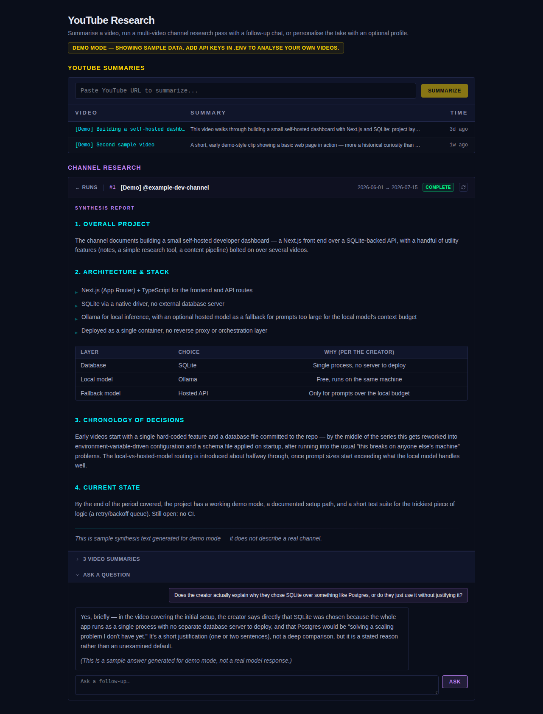

# YouTube Research

A small Next.js app for getting more out of YouTube videos than just watching them:

- **YouTube Summaries** — paste a URL, get a transcript-based summary, stored for later.
- **"Analyse for me"** — a deeper, optionally-personalised take on a saved video, streamed from a local or hosted LLM.
- **Channel Research** — give it a channel and a date range; it fetches every upload in range, summarises each one, synthesises a single report, and lets you ask follow-up questions in a multi-turn chat grounded in the actual transcripts.
- **Save-to-playlist queue** (optional, off by default) — add videos to a YouTube playlist from your phone; a background poller picks them up, summarises them, and removes them from the playlist.


*(Replace with an actual screenshot before sharing — see "Taking a screenshot" below.)*

## Try it with zero API keys

```bash
cp .env.example .env
# edit .env: set DEMO_MODE=true
npm install
npm run dev
```

Open http://localhost:3000. You'll see a few seeded sample rows — a couple of
video summaries, one completed Channel Research run with a sample chat
thread already in it, and one pre-cached "Analyse for me" result. This is
seeded once into an otherwise-empty database; it's read-only in the sense
that submitting a genuinely new video or channel still needs real API keys
and will show a plain error if they're missing. Nothing fakes a live model
call.

## Real setup

```bash
cp .env.example .env
```

Fill in whichever of these you want to use:

| Feature | Needs |
|---|---|
| YouTube Summaries + Analyse for me | `OLLAMA_HOST` (free, local) **or** `ANTHROPIC_API_KEY` |
| Channel Research | the above, **plus** `YOUTUBE_API_KEY` |
| Save-to-playlist queue (optional) | `YOUTUBE_QUEUE_PLAYLIST_ID` + Google OAuth files — see below |

- **Ollama**: install from [ollama.com](https://ollama.com), then `ollama pull mistral:7b` (or any model — set `OLLAMA_MODEL` to match). Used automatically for prompts under `LOCAL_TOKEN_BUDGET` tokens (default 6000); everything larger goes to Anthropic if configured.
- **Anthropic**: get a key at [console.anthropic.com](https://console.anthropic.com).
- **YouTube Data API key**: enable "YouTube Data API v3" at [console.cloud.google.com/apis/credentials](https://console.cloud.google.com/apis/credentials) and create an API key. Free tier is generous for personal use.

Then:

```bash
npm install
npm run dev
```

The database schema is created automatically from `schema.sql` on first
start — there's nothing to migrate by hand.

## Architecture

**Storage.** A single SQLite file (`better-sqlite3`, not a server) at
`$DATA_DIR/youtube.db`, schema applied from `schema.sql` on startup. No ORM,
no migrations tool — the schema is small enough that one file is simpler
than either. `DATA_DIR` also holds `youtube-analyses.json`, the cache for
the "Analyse for me" panel; both need `DATA_DIR` to be a writable directory
(the default, `./data`, always is — this only bites you if you mount
something read-only over it in a container, which is exactly the bug this
app's README is honest about: an earlier version of this code lived in a
deployment where that mount actually was read-only, so every cached
analysis silently failed to save. Fixed here by using an ordinary writable
directory; there's no footgun left to avoid, just worth knowing why
`DATA_DIR` has to be writable).

**YouTube Summaries pipeline** (`app/api/youtube/route.ts`): extract video
ID → fetch transcript (`features/youtube/transcript.ts`, via the
`youtube-transcript` package — reads YouTube's public caption endpoint
in-process, no browser, no Docker) → summarise with whichever model is in
budget → store. "Analyse for me" (`features/youtube/analyse-stream.ts`) is a
separate, optional, deeper pass over the same transcript, streamed to the
browser and cached so you only pay for it once per video.

**Channel Research pipeline** (`features/youtube/channel-research-pipeline.ts`):
resolve the channel via the official YouTube Data API → list its uploads in
the given date range (paging stops as soon as it passes the start date,
rather than walking the whole channel history) → fetch + summarise each
video's transcript (chunked map-reduce if a transcript is too long for one
call) → synthesise one report across all of them. It runs as an ordinary
`async` function the API route calls without awaiting ("fire and forget"),
inside the same Next.js server process — no child process, no queue, no
separate worker. That's deliberately simple and has one real limitation: if
the server restarts mid-run, that run's row is stuck showing `running`
forever. Fine for a single long-lived process; would need a real job queue
to survive restarts.

**Chat over a run** (`app/api/youtube/channel-research/[id]/ask/route.ts`):
every video's full transcript plus the synthesis go into the system prompt
for that run; your question (and prior turns in the same thread) get
appended as messages. Model choice follows the same local-vs-hosted budget
logic as everything else. Conversation history is persisted per-run, so
reloading the page doesn't lose the thread.

**Model routing** (`features/youtube/llm-stream.ts`): everything estimates
prompt tokens (chars / 4 — good enough for a routing decision, not meant to
be exact) and sends anything under `LOCAL_TOKEN_BUDGET` to Ollama, anything
over to Anthropic. If only one of the two is configured, that's what you
get regardless of size; if neither is, you get a clear error, not a silent
failure.

**Optional profile** (`profile.example.md`): "Analyse for me" can weight its
take against a short markdown description of who you are, if one exists at
`PROFILE_PATH`. Copy `profile.example.md` to `profile.md` and edit it
in — `profile.md` is gitignored, so your real one never gets committed.
Leave it missing and the feature still works, just generically.

**Save-to-playlist queue** (`features/youtube/queue-poller.ts`, started from
`instrumentation.ts`): optional, and off unless *all* of
`YOUTUBE_QUEUE_PLAYLIST_ID`, `YOUTUBE_OAUTH_CLIENT_PATH`, and
`YOUTUBE_OAUTH_TOKEN_PATH` are set — and the client file the second one
points at actually has to exist. If any of that is missing, it logs once at
startup and does nothing else; every other feature in this app works
exactly the same either way. See below for how to turn it on.

## Enabling the save-to-playlist queue (optional)

This lets you add a video to a specific YouTube playlist from your phone's
share sheet, and have it get summarised and removed automatically within a
few minutes — without opening this app at all.

1. In [Google Cloud Console](https://console.cloud.google.com/apis/credentials), create an OAuth 2.0 Client ID of type **Desktop app** (simplest — no redirect URI headaches for local use).
2. Download the client secret JSON. Save it somewhere outside the repo, e.g. `~/.config/youtube-research/oauth-client.json`.
3. In `.env`, set:
   ```
   YOUTUBE_OAUTH_CLIENT_PATH=/absolute/path/to/oauth-client.json
   YOUTUBE_OAUTH_TOKEN_PATH=/absolute/path/to/oauth-token.json
   YOUTUBE_QUEUE_PLAYLIST_ID=<the playlist's ID, from its URL>
   ```
   (`oauth-token.json` doesn't need to exist yet — it's created on first connect.)
4. Start the app, open it, and click **Connect YouTube** in the queue status bar. Approve access — the token file gets written automatically.
5. Add a video to that playlist from anywhere (YouTube's share sheet, the app, etc.) and wait up to `YOUTUBE_QUEUE_POLL_INTERVAL_MS` (default/minimum 5 minutes).

Both file paths are **never committed** — they're real credentials, kept
entirely outside the repo by design (see `.gitignore`).

## Testing

```bash
npm test
```

Covers the queue poller's retry/backoff/already-done logic
(`features/youtube/queue-poller.test.ts`) against a temporary SQLite file —
never the real database, and no network calls.

## Taking a screenshot

Run the app in demo mode (`DEMO_MODE=true`), open a Channel Research run
with its synthesis and chat thread expanded, and replace
`docs/screenshot.png` with that.

## What this app deliberately doesn't do

- No scraping or browser automation for anything — channel listing goes
  through the official YouTube Data API; transcript fetching reads the same
  public caption endpoint the most common Python library for this also
  uses, just from Node directly, in-process.
- No Docker-in-Docker, no mounted Docker socket, no shelling out to `python3`
  for database access — SQLite is a normal in-process dependency
  (`better-sqlite3`), same as any other npm package.
- No analytics, telemetry, or anything that leaves this machine besides the
  API calls you've explicitly configured (YouTube, Ollama, Anthropic).
